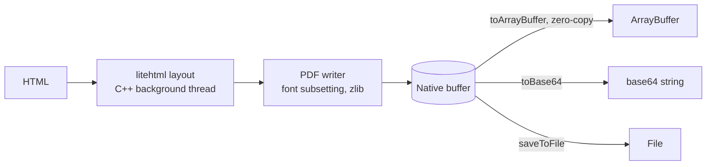

# react-native-nitro-pdf

HTML to PDF for React Native, without a WebView.
Pages are laid out and written in C++ on a background thread with [Nitro Modules](https://nitro.margelo.com), and you get the PDF in the form you need: an `ArrayBuffer`, a base64 string or a file.

[](https://www.npmjs.com/package/react-native-nitro-pdf)
[](https://www.npmjs.com/package/react-native-nitro-pdf)
[](https://github.com/nitinshukla/react-native-nitro-pdf/blob/main/LICENSE)

```ts
import { NitroPdf } from 'react-native-nitro-pdf'

const pdf = await NitroPdf.generate({ html: '<h1>Hello, PDF</h1>' })

pdf.toArrayBuffer() // bytes, zero-copy
pdf.toBase64() // base64 string
await pdf.saveToFile(`${dir}/hello.pdf`) // file
```

Coming from react-native-html-to-pdf or expo-print? See [Migrating](#migrating).

## Features

- **Fast.** 2.5x to 9x faster than WebView-based generators (react-native-html-to-pdf, expo-print), depending on document size. See [Performance](#performance).
- **No WebView.** Nothing to mount and no browser process to start; generation works the same from a screen, a hook or a background task.
- **The output you need.** A zero-copy `ArrayBuffer` (handed to JavaScript in about 2 µs, whatever the size), a base64 string encoded in C++, or a file.
- **No temp files required.** Upload, encrypt or store a PDF straight from memory.
- **Off the main threads.** JavaScript and the UI stay responsive while a PDF is generated.
- **Real, searchable text.** Fonts are subset and embedded with Unicode mappings, so text can be selected, copied and searched. Bring your own fonts with `registerFont()`.
- **CSS for documents.** Tables, flexbox, gradients, rounded borders, background images, PNG (with transparency) and JPEG.
- **One engine, both platforms.** The same C++ code lays out pages on iOS and Android.
- **Fits your stack.** Show PDFs with [react-native-pdf](https://github.com/wonday/react-native-pdf), share them with the system share sheet, store them with your file-system library, or upload them with `fetch`.

## Requirements

- React Native with [`react-native-nitro-modules`](https://github.com/mrousavy/nitro) (tested on 0.86 with the New Architecture)
- iOS 15.1+ · Android 7.0+ (API 24)

## Installation

```sh
npm install react-native-nitro-pdf react-native-nitro-modules
cd ios && pod install
```

Expo works with a [development build](https://docs.expo.dev/develop/development-builds/introduction/) (`npx expo prebuild` or EAS Build). Expo Go cannot load custom native code; use expo-print there.

## Usage

### Generate a PDF

```ts
import { NitroPdf } from 'react-native-nitro-pdf'

const pdf = await NitroPdf.generate({
  html: `
    <h1>Invoice #1042</h1>
    <table>
      <tr><td>Coffee</td><td>₹240.00</td></tr>
      <tr><td>Sandwich</td><td>₹180.00</td></tr>
    </table>`,
})

pdf.pageCount // 1
pdf.byteLength // size in bytes
```

`generate()` returns a `PdfDocument` that keeps the PDF in native memory. Convert it to whichever form you need, as many times as you like.

### Choose the output

| You need                                   | Use                          | Notes                                |
| ------------------------------------------ | ---------------------------- | ------------------------------------ |
| Bytes for an upload, encryption or storage | `pdf.toArrayBuffer()`        | Zero-copy view of the native memory. |
| A string for a JSON body or a `data:` URI  | `pdf.toBase64()`             | Encoded in C++.                      |
| A file for sharing, printing or a viewer   | `await pdf.saveToFile(path)` | Writes on a background thread.       |

### Show it with react-native-pdf

```tsx
import Pdf from 'react-native-pdf'

// From memory, as a data URI
<Pdf source={{ uri: `data:application/pdf;base64,${pdf.toBase64()}` }} style={{ flex: 1 }} />

// Or from a file
await pdf.saveToFile(path)
<Pdf source={{ uri: `file://${path}` }} style={{ flex: 1 }} />
```

### Upload it

```ts
await fetch('https://api.example.com/invoices', {
  method: 'POST',
  headers: { 'Content-Type': 'application/pdf' },
  body: pdf.toArrayBuffer(),
})
```

### Save it

```ts
await pdf.saveToFile(`${documentsDirectory}/invoice-1042.pdf`)
```

`saveToFile()` takes an absolute path or a `file://` URL. Get the app's directories from the file-system library you already use, for example `expo-file-system`, `react-native-blob-util` or `react-native-fs`.

### Page setup

```ts
await NitroPdf.generate({
  html,
  pageSize: 'Letter', // 'A4' (default) | 'Letter' | 'Legal'
  landscape: true,
  margins: { top: 72, right: 54, bottom: 72, left: 54 }, // points, 72 pt = 1 inch
})

// Or any custom size, in points
await NitroPdf.generate({ html, width: 288, height: 432 }) // 4 x 6 in label
```

Content flows across as many pages as it needs. Page breaks avoid splitting lines of text and images.

### Images

```ts
await NitroPdf.generate({
  html: `
    
    `,
  baseUrl: '/path/to/assets', // resolves relative src and url(...)
})
```

PNG and JPEG are supported, from local files or `data:` URIs. JPEGs are embedded as-is, without re-encoding.

### Custom fonts

```ts
NitroPdf.registerFont('Inter', '/path/to/Inter-Regular.ttf', 400, false)
NitroPdf.registerFont('Inter', '/path/to/Inter-Bold.ttf', 700, false)

await NitroPdf.generate({
  html: `<p style="font-family: Inter">Hello <b>bold</b> Inter</p>`,
})
```

TrueType and OpenType fonts are supported, and only the glyphs a document uses are embedded. Without a registered font, the platform's system fonts are used. When a family has no bold or italic face, a matching style is synthesized.

## Migrating

### From react-native-html-to-pdf

| react-native-html-to-pdf                        | react-native-nitro-pdf                   |
| ----------------------------------------------- | ---------------------------------------- |
| `generatePDF({ html })`                         | `NitroPdf.generate({ html })`            |
| `fileName`, `directory`, then `result.filePath` | `await pdf.saveToFile(path)`             |
| `base64: true`, then `result.base64`            | `pdf.toBase64()`                         |
| `result.numberOfPages`                          | `pdf.pageCount`                          |
| `width`, `height`                               | `width`, `height` (points) or `pageSize` |
| `padding`, `paddingTop`, …                      | `margins` (points)                       |
| `baseURL`                                       | `baseUrl`                                |
| `bgColor`                                       | CSS `background` on `body`               |

### From expo-print

| expo-print                                   | react-native-nitro-pdf                   |
| -------------------------------------------- | ---------------------------------------- |
| `Print.printToFileAsync({ html })`           | `NitroPdf.generate({ html })`            |
| `result.uri`                                 | `await pdf.saveToFile(path)`             |
| `base64: true`, then `result.base64`         | `pdf.toBase64()`                         |
| `result.numberOfPages`                       | `pdf.pageCount`                          |
| `width`, `height`                            | `width`, `height` (points) or `pageSize` |
| `margins` (iOS only)                         | `margins` (points, both platforms)       |
| `Print.printAsync(...)` (system print sheet) | Keep using expo-print for printing       |

Both libraries print through the system WebView, so they support everything a browser does, including JavaScript. react-native-nitro-pdf trades that for speed with its own layout engine; check [HTML and CSS support](#html-and-css-support) for your templates before switching.

## API

### `NitroPdf.generate(options): Promise<PdfDocument>`

| Option            | Type                           | Default            | Description                                                                      |
| ----------------- | ------------------------------ | ------------------ | -------------------------------------------------------------------------------- |
| `html`            | `string`                       |                    | The HTML document, including any `<style>` blocks.                               |
| `baseUrl`         | `string`                       |                    | Directory (absolute path or `file://` URL) used to resolve relative image paths. |
| `pageSize`        | `'A4' \| 'Letter' \| 'Legal'`  | `'A4'`             | Ignored when `width` and `height` are set.                                       |
| `width`, `height` | `number`                       |                    | Custom page size in points.                                                      |
| `margins`         | `{ top, right, bottom, left }` | `36` on every side | Page margins in points.                                                          |
| `landscape`       | `boolean`                      | `false`            | Swaps the page width and height.                                                 |

### `NitroPdf.registerFont(family, path, weight, italic): void`

Registers a TrueType or OpenType font file for use with CSS `font-family`. `weight` is a CSS weight from 1 to 1000.

### `PdfDocument`

| Member                            | Description                                                                  |
| --------------------------------- | ---------------------------------------------------------------------------- |
| `pageCount: number`               | Number of pages.                                                             |
| `byteLength: number`              | Size of the PDF in bytes.                                                    |
| `toArrayBuffer(): ArrayBuffer`    | The PDF bytes as an `ArrayBuffer` that wraps native memory, without copying. |
| `toBase64(): string`              | The PDF as a base64 string.                                                  |
| `saveToFile(path): Promise<void>` | Writes the PDF to an absolute path or `file://` URL.                         |

## Performance

Median time to generate a PDF, measured in the example app against [react-native-html-to-pdf](https://github.com/christopherdro/react-native-html-to-pdf) and [expo-print](https://docs.expo.dev/versions/latest/sdk/print/). All libraries produce the same output for each row: a file, a base64 string, or bytes in JavaScript (for the WebView-based libraries, their base64 decoded to a `Uint8Array`).

| Document                      | Output | react-native-nitro-pdf | react-native-html-to-pdf |    expo-print |
| ----------------------------- | ------ | ---------------------: | -----------------------: | ------------: |
| Receipt, 1 page               | File   |             **1.8 ms** |             15 ms (8.4x) |  12 ms (6.5x) |
|                               | Base64 |             **1.7 ms** |             14 ms (8.1x) |  12 ms (7.2x) |
|                               | Bytes  |             **1.6 ms** |             15 ms (9.3x) |  13 ms (7.6x) |
| Invoice, 150 rows (7 pages)   | File   |              **16 ms** |             76 ms (4.8x) |  85 ms (5.4x) |
|                               | Base64 |              **17 ms** |             74 ms (4.5x) |  76 ms (4.6x) |
|                               | Bytes  |              **16 ms** |             73 ms (4.7x) |  71 ms (4.6x) |
| Invoice, 1000 rows (46 pages) | File   |             **140 ms** |            346 ms (2.5x) | 371 ms (2.7x) |
|                               | Base64 |             **140 ms** |            360 ms (2.6x) | 360 ms (2.6x) |
|                               | Bytes  |             **147 ms** |            372 ms (2.5x) | 384 ms (2.6x) |

<details>
<summary>How this was measured</summary>

- Android 16 emulator (arm64, 4 vCPUs) on an Apple M4 Pro; release builds, Hermes, New Architecture, React Native 0.86.
- react-native-nitro-pdf 0.1.0, react-native-html-to-pdf 1.3.0 and expo-print 57.0, same HTML, A4 without margins.
- All libraries are warmed up first, then run in turn (nitro-pdf, html-to-pdf, expo-print, repeat): 10 runs for the smaller documents and 5 for the largest.
- Timings use `performance.now()` in JavaScript, so they include the trip into native code and back.
- Emulators are noisier than phones, so absolute numbers will differ on real devices; the ratios are the useful part. iOS numbers will follow.
- To reproduce, run the [example app](#example-app) and open the **Benchmark** tab.

</details>

## HTML and CSS support

Layout is done by [litehtml](https://github.com/litehtml/litehtml), a lightweight C++ HTML/CSS engine. It covers what documents such as invoices, receipts, reports and tickets usually need:

- Block and inline layout, floats, positioning, tables (including `border-collapse`), flexbox and lists
- Fonts by family, weight and style; underline, overline, line-through and `text-transform`
- Colors with transparency, solid, linear and radial gradient backgrounds, background images
- Borders (solid, dashed, dotted) with `border-radius`, and rounded clipping
- `` and CSS images (PNG, JPEG) from local files or `data:` URIs
- Inline `<style>` blocks and `style` attributes, `@media print`
- The document `<title>` becomes the PDF title

Not supported (yet):

- JavaScript, CSS grid, external stylesheets, and resources loaded over the network
- CSS `page-break-*` / `break-*` properties, and table headers repeating on every page
- Text in complex scripts that needs shaping (Arabic, Devanagari and similar), and conic gradients

## When to use something else

- **Your templates need a full browser**: JavaScript, CSS grid, web fonts or images loaded over the network, or the scripts listed above. react-native-html-to-pdf and expo-print render with the system WebView.
- **You need Expo Go**: expo-print works there; react-native-nitro-pdf needs a development build.
- **You want to print**: show the system print sheet with expo-print or react-native-print; both can print a file saved with `saveToFile()`.
- **You only display existing PDFs**: that's a viewer's job, for example react-native-pdf.

## How it works



1. **Layout.** litehtml parses the HTML and CSS and lays the document out at the page width, using the platform's fonts (CoreText on iOS, `/system/fonts` on Android) or fonts you registered.
2. **Paint.** Drawing commands are recorded once into a display list, then replayed page by page. Page breaks move up so that lines of text and images are not cut in half.
3. **Write.** A purpose-built PDF writer emits PDF 1.7 directly: text as embedded, subset TrueType/OpenType fonts with Unicode mappings, compressed content streams, and images (JPEG passed through, PNG with alpha masks).
4. **Hand off.** The finished PDF stays in native memory until you ask for it as bytes, base64 or a file.

The only platform-specific code is the system font lookup; everything else is shared C++.

## Example app

The [example](example) app has two tabs:

- **Examples**: change the document, page size, margins and orientation, and see the PDF regenerate live, previewed with react-native-pdf from base64 or from a file.
- **Benchmark**: the comparison with react-native-html-to-pdf and expo-print used for the numbers above.

```sh
git clone --recursive https://github.com/nitinshukla/react-native-nitro-pdf.git
cd react-native-nitro-pdf
npm install
cd example
npm run android # or: npm run pod && npm run ios
```

## Contributing

Pull requests are welcome. For major changes, please open an issue first to discuss what you would like to change.

- litehtml and stb are git submodules; after cloning without `--recursive`, run `git submodule update --init`.
- The native interfaces are defined in [`src/specs`](src/specs). After changing them, regenerate the bindings with `npx nitrogen`.

## License

MIT

Built on [litehtml](https://github.com/litehtml/litehtml) (BSD-3-Clause), [gumbo-parser](https://github.com/google/gumbo-parser) (Apache-2.0), [stb_image](https://github.com/nothings/stb) (public domain) and zlib. Bootstrapped with [create-nitro-module](https://github.com/patrickkabwe/create-nitro-module).
