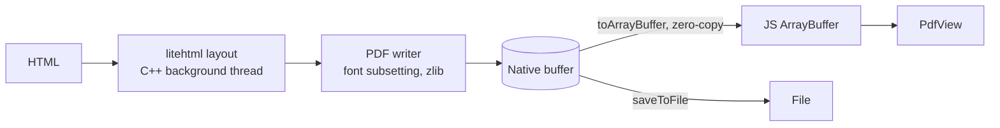

# react-native-nitro-pdf

Fast HTML to PDF for React Native, written in C++ on [Nitro Modules](https://nitro.margelo.com).
No WebView, no base64, no temp files: the PDF is laid out natively and handed to JavaScript as a zero-copy `ArrayBuffer`.

```tsx
import { NitroPdf, PdfView } from 'react-native-nitro-pdf'

const pdf = await NitroPdf.generate({ html: '<h1>Hello, PDF</h1>' })
const data = pdf.toArrayBuffer() // zero-copy: no base64, no file

<PdfView style={{ flex: 1 }} data={data} />
```

## Features

- **Fast.** From HTML to a PDF on screen 2.4–2.9x faster than a WebView-based generator, and up to ~37x faster for small documents. See [Performance](#performance).
- **Zero-copy.** `toArrayBuffer()` wraps the PDF's native memory in about 2 µs, whatever its size. No base64 encoding, no copies.
- **No disk required.** Generate, preview, upload or store a PDF without writing a file (iOS and Android 11+).
- **Off the main threads.** Layout and PDF writing run on a background thread, so JavaScript and the UI stay responsive.
- **Built-in viewer.** `<PdfView>` renders straight from memory with PDFKit on iOS and PdfRenderer on Android.
- **Real, searchable text.** Fonts are subset and embedded with Unicode mappings, so text can be selected, copied and searched. Bring your own fonts with `registerFont()`.
- **Modern CSS where it matters.** Tables, flexbox, gradients, rounded borders, background images, PNG (with transparency) and JPEG.
- **One engine, both platforms.** The same C++ code lays out pages on iOS and Android, so documents come out consistently.
- **Compact output.** Compressed content streams, JPEGs embedded without re-encoding, and fonts subset to the glyphs a document uses.

## Requirements

- React Native 0.78 or newer with the New Architecture
- [`react-native-nitro-modules`](https://github.com/mrousavy/nitro)
- iOS 15.1+ · Android 7.0+ (API 24)

## Installation

```sh
npm install react-native-nitro-pdf react-native-nitro-modules
cd ios && pod install
```

Expo works with a development build (`npx expo prebuild`); Expo Go does not include custom native code.

## Usage

### Generate a PDF

```ts
import { NitroPdf } from 'react-native-nitro-pdf'

const pdf = await NitroPdf.generate({
  html: `
    <h1>Invoice #1042</h1>
    <table>
      <tr><td>Coffee</td><td>₹240.00</td></tr>
      <tr><td>Sandwich</td><td>₹180.00</td></tr>
    </table>`,
})

pdf.pageCount // 1
pdf.byteLength // size in bytes
```

`generate()` returns a `PdfDocument` that owns the bytes in native memory. Nothing is copied until you ask for it.

### Show it

```tsx
import { useEffect, useState } from 'react'
import { NitroPdf, PdfView } from 'react-native-nitro-pdf'

function InvoicePreview({ html }: { html: string }) {
  const [data, setData] = useState<ArrayBuffer>()

  useEffect(() => {
    NitroPdf.generate({ html }).then((pdf) => setData(pdf.toArrayBuffer()))
  }, [html])

  return (
    <PdfView
      style={{ flex: 1 }}
      data={data}
      onLoad={(pageCount) => console.log(`Showing ${pageCount} pages`)}
      onError={(message) => console.warn(message)}
    />
  )
}
```

`<PdfView>` also accepts a `path` to show an existing PDF file. Keep `data` stable (in state or `useMemo`); a new buffer reloads the document.

### Upload, share or store the bytes

```ts
const bytes = pdf.toArrayBuffer() // zero-copy view of the PDF

await fetch('https://api.example.com/invoices', {
  method: 'POST',
  headers: { 'Content-Type': 'application/pdf' },
  body: bytes,
})
```

Anything that accepts an `ArrayBuffer` or `Uint8Array` works: encryption, hashing, MMKV, SQLite and so on.

### Save to a file

```ts
await pdf.saveToFile(`${documentsDirectory}/invoice-1042.pdf`)
```

`saveToFile()` takes an absolute path or a `file://` URL and writes on a background thread. Get the app's directories from the file-system library you already use (for example `expo-file-system` or `react-native-fs`).

### Page setup

```ts
await NitroPdf.generate({
  html,
  pageSize: 'Letter', // 'A4' (default) | 'Letter' | 'Legal'
  landscape: true,
  margins: { top: 72, right: 54, bottom: 72, left: 54 }, // points, 72 pt = 1 inch
})

// Or any custom size, in points
await NitroPdf.generate({ html, width: 288, height: 432 }) // 4 x 6 in label
```

Content flows across as many pages as it needs. Page breaks avoid splitting lines of text and images.

### Images

```ts
await NitroPdf.generate({
  html: `
    
    `,
  baseUrl: '/path/to/assets', // resolves relative src and url(...)
})
```

PNG and JPEG are supported, from local files or `data:` URIs. JPEGs are embedded as-is, without re-encoding.

### Custom fonts

```ts
NitroPdf.registerFont('Inter', '/path/to/Inter-Regular.ttf', 400, false)
NitroPdf.registerFont('Inter', '/path/to/Inter-Bold.ttf', 700, false)

await NitroPdf.generate({
  html: `<p style="font-family: Inter">Hello <b>bold</b> Inter</p>`,
})
```

TrueType and OpenType fonts are supported, and only the glyphs a document uses are embedded. Without a registered font, the platform's system fonts are used. When a family has no bold or italic face, a matching style is synthesized.

## API

### `NitroPdf.generate(options): Promise<PdfDocument>`

| Option | Type | Default | Description |
| --- | --- | --- | --- |
| `html` | `string` | | The HTML document, including any `<style>` blocks. |
| `baseUrl` | `string` | | Directory (absolute path or `file://` URL) used to resolve relative image paths. |
| `pageSize` | `'A4' \| 'Letter' \| 'Legal'` | `'A4'` | Ignored when `width` and `height` are set. |
| `width`, `height` | `number` | | Custom page size in points. |
| `margins` | `{ top, right, bottom, left }` | `36` on every side | Page margins in points. |
| `landscape` | `boolean` | `false` | Swaps the page width and height. |

### `NitroPdf.registerFont(family, path, weight, italic): void`

Registers a TrueType or OpenType font file for use with CSS `font-family`. `weight` is a CSS weight from 1 to 1000.

### `PdfDocument`

| Member | Description |
| --- | --- |
| `pageCount: number` | Number of pages. |
| `byteLength: number` | Size of the PDF in bytes. |
| `toArrayBuffer(): ArrayBuffer` | The PDF bytes as an `ArrayBuffer` that wraps native memory, without copying. |
| `saveToFile(path): Promise<void>` | Writes the PDF to an absolute path or `file://` URL. |

### `<PdfView>`

Accepts all `View` props, plus:

| Prop | Type | Description |
| --- | --- | --- |
| `data` | `ArrayBuffer` | PDF bytes, for example `pdf.toArrayBuffer()`. Rendered straight from memory. |
| `path` | `string` | Absolute path or `file://` URL of a PDF. Used when `data` is not set. |
| `onLoad` | `(pageCount: number) => void` | Called once the document is open and its first page is ready. |
| `onError` | `(message: string) => void` | Called when the PDF cannot be opened. |

## Performance

Generate a PDF, then show it in the same `<PdfView>`. react-native-nitro-pdf hands over an in-memory `ArrayBuffer`; [react-native-html-to-pdf](https://github.com/christopherdro/react-native-html-to-pdf) hands over the file it writes.

| Document | Pages | react-native-nitro-pdf | react-native-html-to-pdf | |
| --- | --- | ---: | ---: | ---: |
| Receipt | 1 | **34 ms** | 100 ms | 2.9x |
| Invoice, 150 rows | 7 / 8 | **50 ms** | 135 ms | 2.7x |
| Invoice, 1000 rows | 46 / 48 | **186 ms** | 451 ms | 2.4x |

When the goal is the PDF as bytes in JavaScript (to upload or store), the gap is larger because html-to-pdf returns base64 that must be decoded:

| Document | react-native-nitro-pdf | react-native-html-to-pdf | |
| --- | ---: | ---: | ---: |
| Receipt | **1.6 ms** | 60 ms | ~37x |
| Invoice, 150 rows | **20 ms** | 123 ms | 6.2x |
| Invoice, 1000 rows | **158 ms** | 451 ms | 2.9x |

Generating 23 of these PDFs back to back took 0.9 s with no files written, compared with 4.8 s and 23 files.

<details>
<summary>How this was measured</summary>

- Android 16 emulator (arm64, 4 vCPUs) on an Apple M4 Pro; release builds, Hermes, New Architecture, React Native 0.86.
- react-native-nitro-pdf 0.1.0 and react-native-html-to-pdf 1.3.0, same HTML, A4 without margins. Medians of 5 to 10 runs after a warm-up.
- Timings use `performance.now()` in JavaScript, so they include the trip into native code and back.
- Emulators are noisier than phones, so absolute numbers will differ on real devices; the ratios are the useful part. iOS numbers will follow.
- To reproduce, run the [example app](#example-app) and open the **Benchmark** tab.

</details>

## HTML and CSS support

Layout is done by [litehtml](https://github.com/litehtml/litehtml), a lightweight C++ HTML/CSS engine. It covers what documents such as invoices, receipts, reports and tickets usually need:

- Block and inline layout, floats, positioning, tables (including `border-collapse`), flexbox and lists
- Fonts by family, weight and style; underline, overline, line-through and `text-transform`
- Colors with transparency, solid, linear and radial gradient backgrounds, background images
- Borders (solid, dashed, dotted) with `border-radius`, and rounded clipping
- `` and CSS images (PNG, JPEG) from local files or `data:` URIs
- Inline `<style>` blocks and `style` attributes, `@media print`
- The document `<title>` becomes the PDF title

Not supported (yet):

- JavaScript, CSS grid, external stylesheets, and resources loaded over the network
- CSS `page-break-*` / `break-*` properties, and table headers repeating on every page
- Text in complex scripts that needs shaping (Arabic, Devanagari and similar), and conic gradients

If you need pixel-identical browser rendering of arbitrary web pages, a WebView-based library is still the better fit.

## How it works



1. **Layout.** litehtml parses the HTML and CSS and lays the document out at the page width, using the platform's fonts (CoreText on iOS, `/system/fonts` on Android) or fonts you registered.
2. **Paint.** Drawing commands are recorded once into a display list, then replayed page by page. Page breaks move up so that lines of text and images are not cut in half.
3. **Write.** A purpose-built PDF writer emits PDF 1.7 directly: text as embedded, subset TrueType/OpenType fonts with Unicode mappings, compressed content streams, and images (JPEG passed through, PNG with alpha masks).
4. **Hand off.** The finished PDF stays in native memory. `toArrayBuffer()` exposes it to JavaScript without a copy, and `<PdfView>` reads the same memory.

The only platform-specific code is the font lookup and the viewer; everything else is shared C++.

## Example app

The [example](example) app has two tabs:

- **Examples**: change the document, page size, margins and orientation, and see the PDF regenerate and render live.
- **Benchmark**: the side-by-side comparison used for the numbers above.

```sh
npm install
cd example
npm run android # or: npm run pod && npm run ios
```

## Contributing

Pull requests are welcome. For major changes, please open an issue first to discuss what you would like to change.

The native interfaces are defined in [`src/specs`](src/specs). After changing them, regenerate the bindings with `npx nitrogen`.

## License

MIT

Built on [litehtml](https://github.com/litehtml/litehtml) (BSD-3-Clause), [gumbo-parser](https://github.com/google/gumbo-parser) (Apache-2.0), [stb_image](https://github.com/nothings/stb) (public domain) and zlib. Bootstrapped with [create-nitro-module](https://github.com/patrickkabwe/create-nitro-module).
